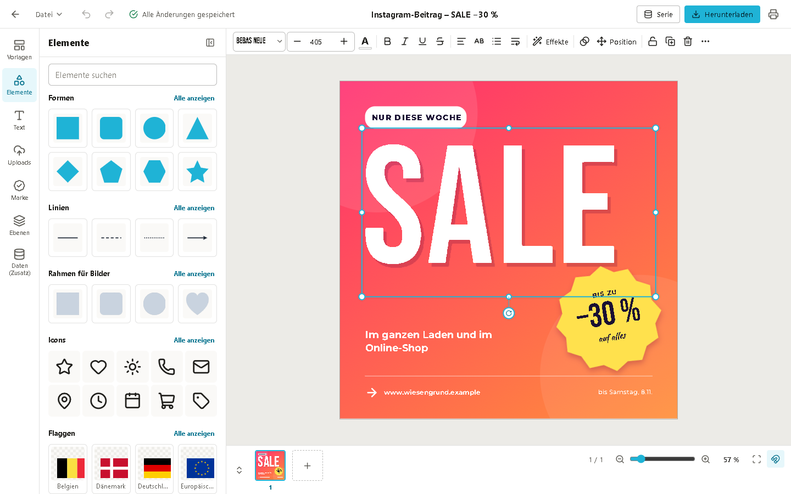
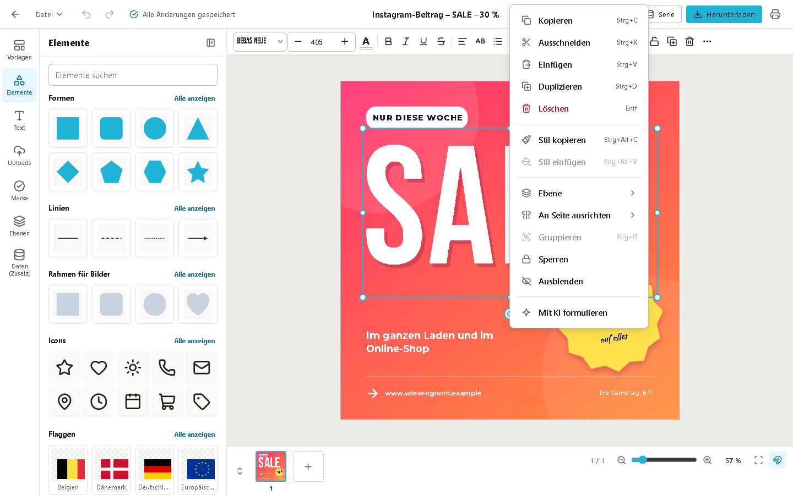
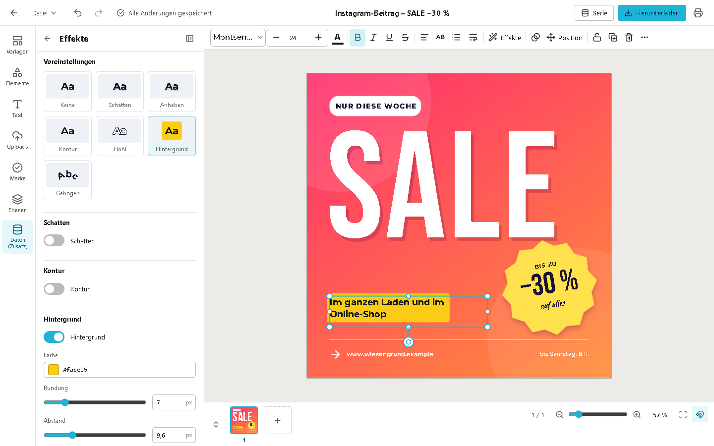
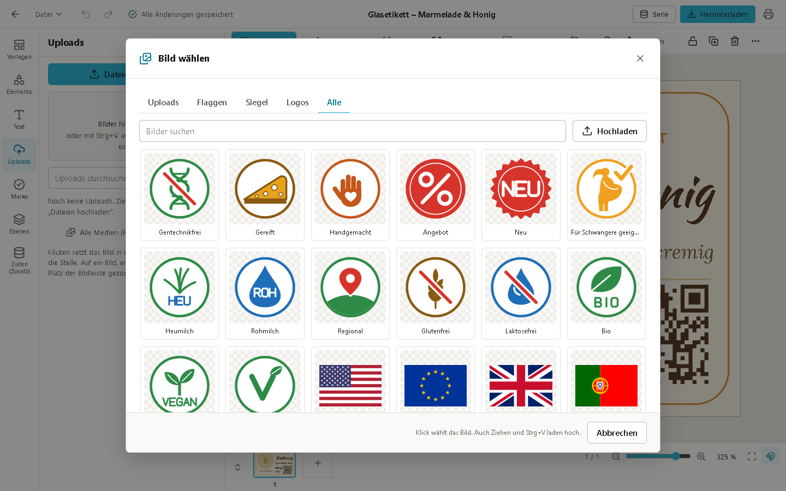
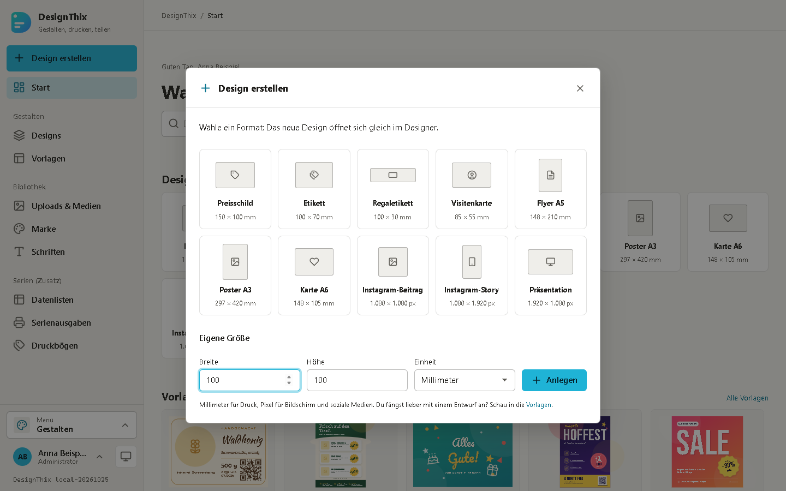
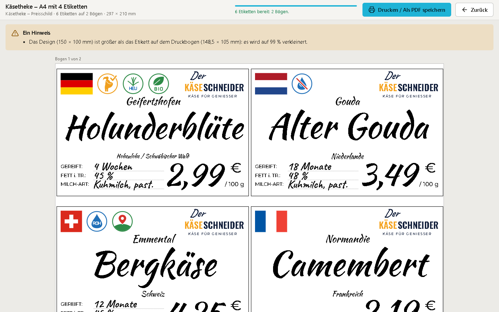
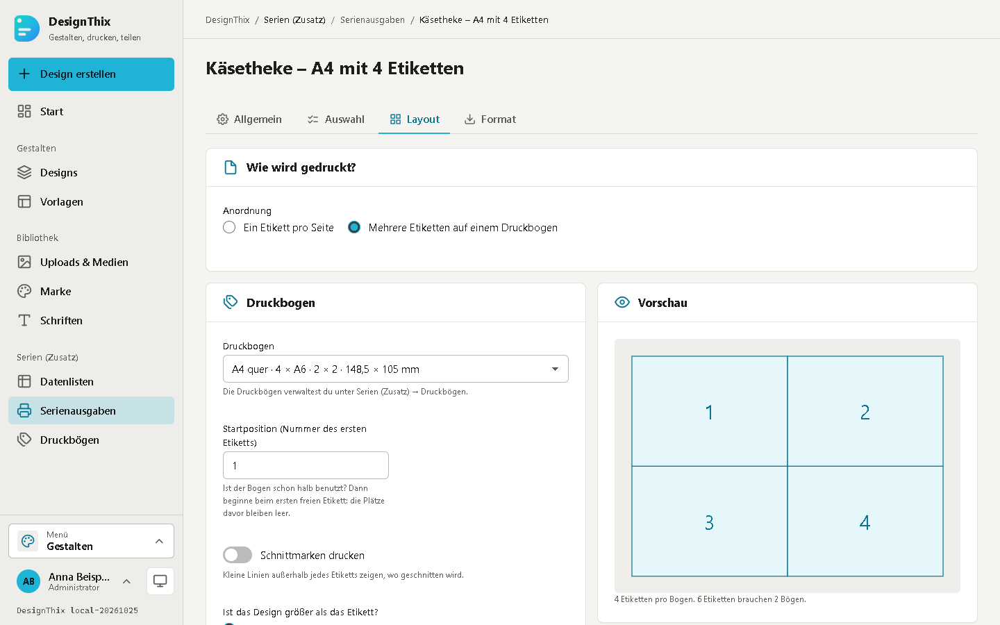
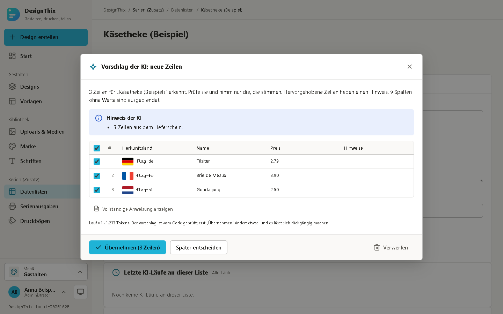

<div align="center">


# DesignThix

**Der Offline-Canva für Etiketten, Karten, Flyer, Poster und Beiträge für soziale Medien.**

Du wählst ein Format oder eine fertige Vorlage, gestaltest im Designer wie in Canva und lädst das Ergebnis als PNG, JPG, SVG oder PDF herunter oder druckst es.
Und wenn du viele ähnliche Etiketten brauchst, füllt DesignThix ein Design aus einer Datenliste: ein Design, viele Etiketten (Zusatz *Serien*).

</div>



DesignThix ist ein Docker-Container mit einer PostgreSQL-Datenbank. Es läuft auf deinem eigenen Server oder Rechner, lädt nichts aus dem Internet nach
(Schriften, Bilder und Symbole liegen in der App) und lässt sich auf Handy und Desktop als App installieren.

## Was DesignThix kann

- **Start mit einem Klick:** Die Startseite fragt „Was möchtest du heute gestalten?“. Ein Klick auf ein Format (Preisschild, Etikett, Regaletikett, Visitenkarte, Flyer A5, Poster A3, Karte A6, Instagram-Beitrag
  und -Story, Präsentation oder eine eigene Größe in mm oder px) legt das leere Design an und öffnet den Designer. Darunter stehen die Vorlagen und die zuletzt bearbeiteten Designs; die Suche findet Designs und Vorlagen.
- **Vorlagen:** Zehn fertige Entwürfe zum Anpassen (Preisschilder, Regaletikett mit EAN-Code, Glasetikett mit QR-Code, Visitenkarte und Grußkarte mit zwei Seiten, Flyer, Poster, Instagram-Beitrag und -Story),
  nach Kategorien sortiert, mit Suche. „Vorlage verwenden“ macht eine Kopie; die Vorlage bleibt, wie sie ist.
- **Designer:** Eine Leiste mit Reitern (Vorlagen, Elemente, Text, Uploads, Marke, Ebenen, Daten) und eine Werkzeugleiste, die zur Auswahl passt. Mehrere Seiten je Design, Gruppen, Ebenen, Ausrichten und Einrasten
  mit Abstandshilfen, Kontextmenü mit der rechten Maustaste, Tastenkürzel, Rückgängig, **automatisches Speichern**. Mit Maus, Stift und Finger; auf dem Handy mit Reiterleiste unten.
- **Elemente und Symbole:** Formen und Linien, Bildrahmen (rund, Herz, Stern …), rund 1 900 Symbole (Lucide) mit deutscher Suche, Flaggen und Siegel, **QR-Codes** und Strichcodes (EAN-13, EAN-8, Code 128).
- **Text:** Überschrift, Zwischenüberschrift, Fließtext und zehn **Schriftkombinationen**; Effekte wie Schatten, Kontur, Hintergrund und Kreisbogen; Listen, Abstände, Unterstreichen, Großbuchstaben; zwölf Schriften.
- **Bilder:** Zuschneiden, Spiegeln, Masken, Rand und Filter (Helligkeit, Kontrast, Sättigung, Unschärfe, Schwarzweiß); Farben mit Verlauf, Markenfarben und Pipette.
- **Uploads per Drag & Drop und Einfügen:** Bilder und Schriften aus dem Explorer auf die Fläche ziehen oder mit Strg+V einfügen (auch Screenshots und Text); ein **Medienbrowser** zeigt alles mit Vorschau.
- **Marke:** Markenfarben, Markenschriften und Logos einmal festlegen, im Designer überall bereit.
- **Herunterladen und Drucken:** PNG, JPG, SVG und PDF/Druck, einzelne Seiten oder alle (mehrere Seiten als ZIP), transparenter Hintergrund, ×1 bis ×4 oder eigene Auflösung.
- **Rollen:** Administrator, Gestalter, Betrachter. Oberfläche auf Deutsch, hell und dunkel.
- **Installierbare App (PWA)** mit Offline-Anzeige zuletzt geöffneter Seiten; der Designer behält ungespeicherte Änderungen und speichert, sobald die Verbindung zurück ist.

### Zusatz: Serien mit Daten

Wer viele ähnliche Etiketten oder Karten braucht, nutzt zusätzlich (Menü *Serien (Zusatz)*):

- **Datenlisten und Platzhalter:** Felder wie Name, Preis, Herkunftsland in einem Design (`{{Name}}`); Datenlisten mit Tabellen-Editor, CSV-Import und -Export, Einfügen aus Excel.
- **Serienausgaben:** Druck oder PDF über den Browser (ein Etikett pro Seite oder mehrere auf einem Druckbogen, mit Schnittmarken und Startposition) und PNG-ZIP. Dazu der **Einzeldruck**
  eines Etiketts mit eingetippten Werten und der Export und Import eines Designs als Datei.
- **Druckbögen:** wie die Etiketten auf dem Papier sitzen (A4 mit 2 × 4, 3 × 8 … Etiketten, eigene Bögen).
- **KI-Import (optional):** Daten aus Text übernehmen, eine Spalte füllen lassen, Texte vorschlagen lassen – immer mit Vorschau, Protokoll und Rückgängig.

## So sieht es aus

Beim ersten Start sind die zehn Vorlagen da, dazu ein Beispiel für die Serien mit Daten: die Vorlage **Käsetheke – Preisschild**, die Datenliste **Käsetheke (Beispiel)** mit sechs Käsen und die Serienausgabe
**Käsetheke – A4 mit 4 Etiketten**. Damit kannst du alles ausprobieren; was du löschst, kommt nicht wieder (eine Vorlage, die eine spätere Version neu mitbringt, wird einmal ergänzt).

**Gestalten**

| | |
|---|---|
|  |  |
| **Start:** „Was möchtest du heute gestalten?“, Formate mit einem Klick, Vorlagen und zuletzt bearbeitete Designs | **Vorlagen:** fertige Entwürfe nach Kategorien, mit Suche |
|  |  |
| **Kontextmenü** mit der rechten Maustaste: Kopieren, Stil übertragen, Ebene, Ausrichten, Gruppieren, Sperren | **Text:** Überschriften und zehn fertige Schriftkombinationen |
|  |  |
| **Texteffekte:** Schatten, Kontur, Hintergrund, Kreisbogen – mit Vorschau | **Medienbrowser:** Uploads, Flaggen, Siegel und Logos mit Suche; Bilder auch per Ziehen und Strg+V |
|  |  |
| **Design erstellen:** ein Format wählen oder eine eigene Größe in mm oder px eingeben | **Herunterladen:** PNG, JPG, SVG oder PDF, Größe und transparenter Hintergrund |
|  |  |
| **Auf dem Handy:** der Designer mit Reiterleiste unten und einer Werkzeugleiste zum Wischen | **Start auf dem Handy:** dieselben Formate, Vorlagen und Designs, einspaltig |

**Serien (Zusatz)**

| | |
|---|---|
|  |  |
| **Daten im Designer:** Vorschau mit einer Zeile der Datenliste, Felder und Anzeigebedingungen | **Datenliste:** eine Zeile je Etikett, Bilder aus der Medienbibliothek |
|  |  |
| **Ausgabe:** das Preisschild der Käsetheke, sechs Käse auf zwei Druckbögen | **Serienausgabe:** Design, Datenliste, Auswahl, Druckbogen und Format |
|  |  |
| **Uploads & Medien:** Flaggen, Siegel, Logos und Fotos mit eindeutigem Schlüssel | **KI-Vorschlag:** neue Zeilen aus einem eingefügten Text, du übernimmst, was stimmt |

## Starten

DesignThix besteht aus einem Container (die App) und einer PostgreSQL-Datenbank. Die Datenbank legt sich beim Start selbst an und migriert sich; Umgebungsvariablen
brauchst du nicht.

| Stack | Datei | Image | App | pgAdmin | Postgres |
|---|---|---|---|---|---|
| **Release** (Branch `main`) | `docker-compose.yml` | `ghcr.io/real-ttx/designthix:latest` | http://localhost:3043 | – | – |
| **Entwicklung** (Branch `dev`) | `docker-compose.dev.yml` | `ghcr.io/real-ttx/designthix:nightly` | http://localhost:3043 | http://localhost:3044 | – |
| **Lokal** (baut aus dem Ordner) | `docker-compose.local.yml` | `designthix:local` | http://localhost:3043 | http://localhost:3044 | `localhost:3045` |

```bash
# Release
docker compose up -d
# Entwicklung (nightly)
docker compose -f docker-compose.dev.yml up -d
# Lokal: baut das Image neu und startet den Stack (so wird jede Änderung getestet)
./scripts/redeploy.ps1        # oder ./scripts/redeploy.sh ; mit -Clean / --clean werden die Volumes geleert
```

**Der erste Aufruf** von http://localhost:3043 öffnet den **Einrichtungsassistenten**: Er legt das Konto der Administration an (es gibt kein Standardpasswort). Danach
legst du unter *Verwaltung > Benutzer* weitere Konten an: *Gestalter* ändern Designs, Medien, Schriften, Marke, Datenlisten und Serienausgaben, *Betrachter* sehen alles an und führen Serienausgaben
aus. Für mehr als das lokale Netz gehört ein Reverse-Proxy mit TLS davor.

Updates: `docker compose pull && docker compose up -d`. Im Volume `web-data` liegen die Schlüssel der App und die KI-Schlüssel; ohne sie sind gespeicherte Geheimnisse nicht lesbar
(sie gehören nicht in ein Backup der Datenbank, aber in ein eigenes). Die Datenbank liegt im Volume `db-data`.

### Versionen

Es gibt zwei Branches: **`main`** ist das Release, **`dev`** der Entwicklungsstand. Die GitHub-Action baut und testet (gegen PostgreSQL) und veröffentlicht ein Multi-Arch-Image
(amd64, arm64) nach `ghcr.io/real-ttx/designthix`:

| Branch | Version | Tags des Images |
|---|---|---|
| `main` | `<major>.<minor>.<build>-<datum>`, zum Beispiel `0.1.42-20261024` | `<version>`, `latest`, `release` |
| `dev` | `nightly-<build>-<datum>` | `<version>`, `nightly` |
| lokal gebaut | `local-<datum>` | `designthix:local` |

Major und Minor stehen in `Directory.Build.props`, die Build-Nummer ist die Nummer des Laufs der Action. Die Version steht links unten im Menü; ein Klick öffnet *Über DesignThix*.

## Serien mit Daten: Platzhalter

Ein **Feld** hat einen Schlüssel (`Name`, `Preis`, `Land`), eine Beschriftung, eine Art und einen Beispielwert. Du legst Felder im Designer an (Reiter *Daten (Zusatz)*) und
benutzt sie so:

- **In einem Text:** `{{Name}}` wird durch den Wert der Datenliste ersetzt. Der Text darf mehr enthalten („Heute: {{Name}} für {{Preis}} €“). Groß und klein ist egal, Leerzeichen
  in den Klammern auch. Ein unbekannter Schlüssel bleibt leer; der Designer warnt davor.
- **Als Bild:** Ein Bild oder ein Platz einer **Bildleiste** wird an ein Feld der Art *Bild* gebunden. In der Datenliste steht dann der **Schlüssel eines Mediums** (`flag-de`, `icon-bio`);
  die Zelle bietet die Medien mit Vorschau zur Auswahl an. Die Bildleiste stellt die Bilder in einer Reihe nebeneinander, **leere Plätze fallen weg** und die übrigen rücken auf.
- **Ausblenden, wenn leer:** Im Reiter *Daten (Zusatz)* hat das ausgewählte Element die *Anzeigebedingung* „Nur wenn <Feld> gefüllt ist“. So verschwindet eine Zeile samt Beschriftung
  („GEREIFT:“ mit ihrer gepunkteten Linie), wenn die Datenliste dafür nichts hat.
- **Schrift, die sich anpasst:** „Verkleinern, bis es passt“ macht die Schrift so groß wie möglich, ohne dass sie das Feld verlässt (bis zu einer Mindestgröße). Lange Namen bleiben so im Etikett.
- **Zahlen und Preise:** Felder der Art *Preis* zeigen den Wert mit zwei Nachkommastellen im deutschen Format (`2,99`), egal ob in der Liste `2,99` oder `2.99` steht; *Zahl* zeigt so
  viele Stellen, wie eingestellt sind. Das Eurozeichen und die Einheit („/ 100 g“) sind eigene Elemente, die du neben den Preis setzt.
- **Vorschau mit Daten:** Im Reiter *Daten (Zusatz)* wählst du eine Datenliste und blätterst mit ◀ ▶ durch ihre Zeilen. Eine Spalte der Liste füllt das Feld mit gleichem Schlüssel; „Spalten aus Design
  übernehmen“ legt die Spalten einer Liste aus den Feldern des Designs an.

## Serienausgaben

Eine **Serienausgabe** speichert, was gedruckt wird: Design, Datenliste, Auswahl der Zeilen (alle, nur aktive, ausgewählte), Kopien je Zeile, Layout und Format. *Ausführen* öffnet die Seite, die
jedes Etikett zeichnet.

- **Druck / PDF:** *Drucken / Als PDF speichern* ruft den Druckdialog des Browsers; „Als PDF speichern“ gibt ein PDF in genau der Papiergröße (Schrift eingebettet, Vektoren). Ein Etikett pro
  Seite hat die Größe des Designs; auf einem **Druckbogen** (A4 mit 2 × 4, 3 × 8 … Etiketten, eigene Bögen unter *Druckbögen*) sitzen die Etiketten Zelle für Zelle, auf Wunsch mit **Schnittmarken**.
  Ein Design, das größer als die Zelle ist, wird verkleinert (mit Hinweis). Mit der **Startposition** beginnst du auf einem halb benutzten Bogen beim ersten freien Etikett.
- **PNG-ZIP:** Jedes Etikett als PNG in der Auflösung des Designs (300 dpi voreingestellt), alle in einer ZIP-Datei; die Dateinamen kommen aus einem Muster wie `{Design}-{Nr}-{Name}`.
- **Einzeldruck:** Am Design ein Formular mit den Feldern: Werte eintippen oder Medien wählen, Etikett drucken oder als PNG laden – ohne eine Serienausgabe zu speichern. Das dürfen auch Betrachter.
- Höchstens 2000 Etiketten je Serienausgabe.

## KI-Aktionen

Die KI ist ein Angebot, kein Zwang: Ohne Profil fehlen nur die KI-Knöpfe. Unter *Verwaltung > KI* legt der Administrator ein Profil an (jeder **OpenAI-kompatible Anbieter** mit
API-Schlüssel, zum Beispiel Mistral, OpenAI, DeepSeek, OpenRouter oder ein eigener Server, oder ein **ChatGPT-Konto** per Gerätecode) und stellt Grundanweisung, Ergänzungen je Aktion und Grenzen ein.

| Aktion | Wo | Was geschieht |
|---|---|---|
| **Daten übernehmen** | Datenliste, Reiter *Import/Export* (und Knopf im Zeilen-Raster) | Du fügst Text oder eine Tabelle ein (Lieferantenliste, E-Mail, Speisekarte). Die KI schlägt neue Zeilen vor; Bild-Spalten nehmen nur vorhandene Medien. Du siehst eine Vorschau mit Hinweisen und übernimmst, was stimmt. |
| **Spalte füllen** | Datenliste, Reiter *Zeilen*: Zeilen wählen, *Mit KI füllen* | Du wählst eine Spalte und schreibst, was geschehen soll („Schreibe die Region passend zum Ort“). Die KI sieht nur die gewählten Zeilen und die Spalten, die du ankreuzt. Vorschau alt → neu, dann übernehmen. |
| **Text vorschlagen** | Designer, ein Text ist ausgewählt: Kontextmenü (rechte Maustaste) *Mit KI formulieren* | Bis zu fünf Alternativen; Platzhalter wie `{{Name}}` bleiben erhalten (sonst verwirft der Code den Vorschlag). Ein Klick übernimmt, Strg+Z nimmt zurück. |

Was sich verlassen lässt: Der **Code** prüft jede Antwort der KI (nur bekannte Spalten, Zahlen wie im Raster, Bilder nur aus der erlaubten Liste, keine Skripte, höchstens 500 Zeilen) und entscheidet,
welche Daten die KI überhaupt sieht. *Vollständige Anweisung anzeigen* zeigt vor dem Senden genau den Text, der an die KI geht. Jeder Lauf mit allen Schritten steht unter *Verwaltung > KI > Läufe*; was ein
Lauf geändert hat, lässt sich rückgängig machen (der neueste zuerst). Gestalter sehen und machen ihre eigenen Läufe an der Datenliste rückgängig, Administratoren alle.

**Datenschutz:** Datenlisten, die als „enthält personenbezogene Daten“ markiert sind, lehnt die KI ab, solange der Administrator nicht „Personenbezogene Daten an die KI senden“ eingeschaltet hat.
Empfohlen ist ein Anbieter in der EU (zum Beispiel Mistral). Bei Anbietern in den USA oder in China werden Daten in ein Drittland übermittelt; das gehört in die Datenschutzerklärung (für China gibt es
keinen Angemessenheitsbeschluss). Die API-Schlüssel liegen verschlüsselt im Volume `web-data`, nie in der Datenbank, nie in einem Backup und nie im Browser. Besucher und Adressen werden nur als täglich
wechselnder Hash gezählt.

## Offline und als App

DesignThix ist eine **installierbare App** (PWA): im Browser *Installieren* bzw. auf dem iPhone *Zum Home-Bildschirm*. Die Statusleiste hat die Farbe der App (hell und dunkel), Notch und
Home-Anzeige werden berücksichtigt, Eingabefelder sind auf dem Handy so groß, dass iOS nicht hineinzoomt; Zoomen mit zwei Fingern bleibt erlaubt.

Ohne Verbindung zeigt DesignThix die Seiten, die du schon geöffnet hattest, als **Kopie** mit Hinweis („Du siehst den Stand vom …“). Schriften, Medien und Vorschaubilder bleiben im Zwischenspeicher, damit
Designs auch offline gezeichnet werden und eine schon einmal ausgeführte Serienausgabe wieder gedruckt werden kann. Geändert wird nur mit Verbindung; der **Designer** behält deine ungespeicherten
Änderungen als Entwurf im Browser und speichert, sobald die Verbindung zurück ist (hat in der Zwischenzeit jemand anderes gespeichert, fragt er, ob du deine Fassung als Kopie sichern willst). Kommt die
Verbindung zurück, lädt die Seite sich selbst neu, damit nichts Altes stehen bleibt. Beim Abmelden werden die gemerkten Seiten gelöscht.

## Schriften, Symbole und Lizenzen

- **Schriften** (zwölf Familien, nichts wird aus dem Internet geladen): Montserrat, Bebas Neue, Oswald, Kaushan Script, Caveat, Playfair Display, Lora, Open Sans, Pacifico, Source Sans 3 unter der
  **SIL Open Font License 1.1**; Roboto Slab und Permanent Marker unter der **Apache License 2.0**. Die Lizenztexte liegen in `src/DesignThix/wwwroot/fonts/LICENSES`.
- **Symbole der Oberfläche:** [Lucide](https://lucide.dev) (ISC-Lizenz), über MatUi.
- **Flaggen und Siegel** sind eigene Zeichnungen (keine geschützten Zeichen; die echten Bio- oder g.t.S.-Siegel lädst du selbst unter *Medien* hoch).
- Das Aussehen kommt von **MatUi** aus MatDesign. DesignThix selbst: Matthias Schmoldt.

## Entwickeln

Voraussetzungen: .NET 10 SDK, Docker, Node.js (für die Browser-Prüfungen).

```bash
dotnet build DesignThix.slnx                  # 0 Fehler, 0 Warnungen
dotnet test DesignThix.slnx                   # Unit-Tests; die Integrationstests brauchen PostgreSQL:
DESIGNTHIX_TEST_DB="Host=localhost;Port=3045;Username=designthix;Password=designthix" dotnet test DesignThix.slnx
dotnet tool restore                           # einmal (dotnet-ef)
dotnet ef migrations add <Name> -p src/DesignThix -s src/DesignThix -o Data/Migrations
./scripts/redeploy.ps1                        # Image bauen und den lokalen Stack starten (-Clean: leere Datenbank)
```

- **Browser-Prüfungen** (`tests/e2e`, Playwright mit dem installierten Edge): `cd tests/e2e && npm install && node run-all.js http://localhost:3043` startet Engine, PWA, Demo, Start, Vorlagen, Designer, Canva-Editor, Editor-Inhalte,
  Serienausgabe und KI nacheinander (rund zehn Minuten). Jede einzeln und was sie prüft: [tests/e2e/README.md](tests/e2e/README.md). Sie legen ihre Konten selbst an, wenn die Datenbank leer ist.
- **Screenshots** dieser Seite: `node tests/e2e/screens.js` gegen eine frische, leere Datenbank (`./scripts/redeploy.ps1 -Clean`, oder die App mit `dotnet run` gegen eine neue Datenbank, siehe [CLAUDE.md](CLAUDE.md)), Ergebnis in `docs/images`.
- **MatUi** (Oberflächen-Bibliothek) wird nie in `src/DesignThix/wwwroot/ui` geändert, sondern aus MatDesign geholt: `./scripts/sync-matui.ps1`, geprüft mit `./scripts/check-matui.ps1`.
- Aufbau, Regeln und Stolpersteine für die Arbeit am Code: [CLAUDE.md](CLAUDE.md). Die Baupläne: [docs/PLAN-CANVA.md](docs/PLAN-CANVA.md) (Plan 2: Canva-Stil, Dokumentformat 2), [docs/PLAN.md](docs/PLAN.md) (Plan 1: Produkt, Architektur); der Editor: [docs/EDITOR.md](docs/EDITOR.md).

**Technik:** ASP.NET Core 10 (Razor Pages), Entity Framework Core 10, PostgreSQL 17, MatUi aus MatDesign, GitHub Actions (Build, Tests gegen PostgreSQL, Multi-Arch-Image nach GHCR).

## Lizenz und Autor

Matthias Schmoldt. Die mitgelieferten Schriften stehen unter ihren eigenen Lizenzen (siehe oben), die Symbole unter der ISC-Lizenz von Lucide.
