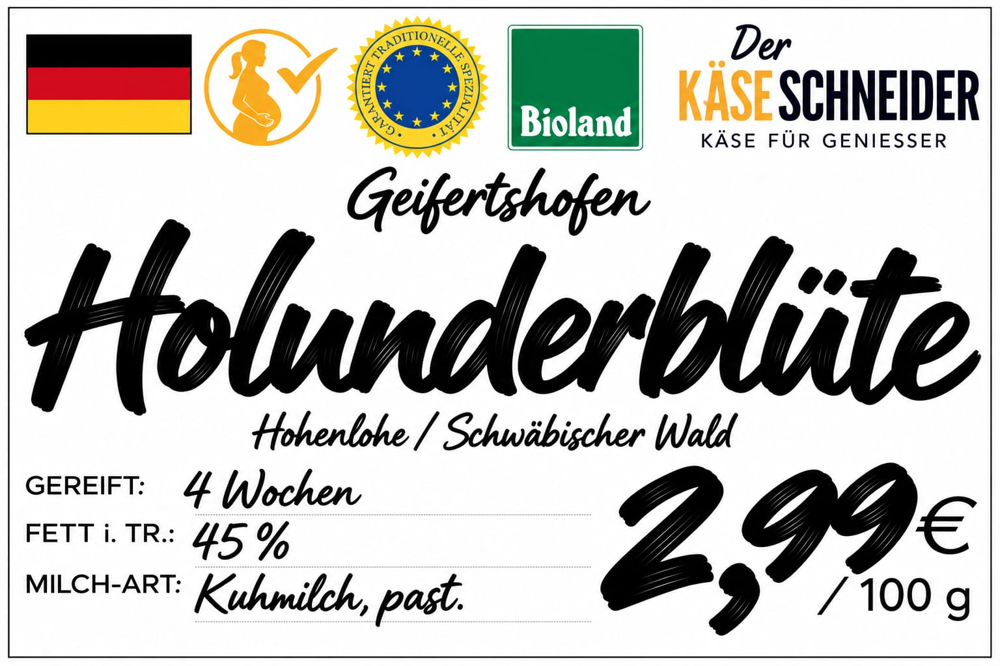

<div align="center">


# DesignThix

**Der Offline-Canva für Etiketten, Karten, Schilder und Plakate – ein Design, viele Etiketten.**

Du gestaltest ein Design einmal, setzt Platzhalter wie `{{Name}}` oder `{{Preis}}` ein und befüllst es aus einer Datenliste.
Gedruckt oder als PNG-ZIP ausgegeben wird jede Zeile der Liste als eigenes Etikett (Serienbrief-Prinzip).

</div>



---

> **Stand:** Das Fundament steht (Anmeldung mit Einrichtungsassistent, Zwei-Faktor-Anmeldung, Benutzer und Rollen, KI-Profile, Aktivitätsprotokoll, installierbare
> App) und die Bibliothek ist da: **Medien** (mitgelieferte Flaggen und Siegel, eigene PNG/JPEG/WebP/GIF/SVG), **Schriften** (freie Schriften, eigene TTF/OTF/WOFF),
> **Datenlisten** (Spalten, Tabellen-Editor, CSV-Import und -Export), **Druckbögen** und die **Designs** als Verzeichnis mit Eigenschaften und Verlauf.
> Dazu kommen der **Designer** und die **Ausgabe**: gespeicherte Ausgaben (Design + Datenliste + Auswahl + Layout) drucken als PDF oder liefern PNG-Bilder in einer ZIP-Datei,
> der **Einzeldruck** druckt ein Etikett mit eingetippten Werten, und Designs lassen sich als Datei exportieren und wieder importieren (siehe [docs/PLAN.md](docs/PLAN.md)).


## Was DesignThix kann (Ziel)

- **Designer:** Text, Bilder, Bildleisten (leere Plätze rücken auf), Formen; Maße in mm oder px; Schrift, die sich verkleinert, bis sie passt
- **Platzhalter und Datenlisten:** Felder wie Name, Preis, Herkunftsland; CSV-Import und -Export, Einfügen aus Excel, KI-Import
- **Medien und Schriften:** eigene Bilder und Schriften, dazu mitgelieferte Flaggen, Siegel und freie Schriften – nichts wird aus dem Internet geladen
- **Ausgabe:** Druck oder PDF (ein Etikett pro Seite oder mehrere auf einem Druckbogen mit Schnittmarken) und PNG-ZIP
- **Rollen:** Administrator, Gestalter, Betrachter
- **Installierbare App (PWA)**, Oberfläche auf Deutsch, hell und dunkel

## Starten

DesignThix besteht aus einem Container (die App) und einer PostgreSQL-Datenbank. Die Datenbank legt sich beim Start selbst an und migriert sich.

| Stack | Datei | Image | App | pgAdmin | Postgres |
|---|---|---|---|---|---|
| **Release** (Branch `main`) | `docker-compose.yml` | `ghcr.io/real-ttx/designthix:latest` | http://localhost:3043 | – | – |
| **Entwicklung** (Branch `dev`) | `docker-compose.dev.yml` | `ghcr.io/real-ttx/designthix:nightly` | http://localhost:3043 | http://localhost:3044 | – |
| **Lokal** (baut aus dem Ordner) | `docker-compose.local.yml` | `designthix:local` | http://localhost:3043 | http://localhost:3044 | `localhost:3045` |

```bash
# Release
docker compose up -d
# Entwicklung (nightly)
docker compose -f docker-compose.dev.yml up -d
# Lokal: baut das Image neu und startet den Stack (so wird jede Änderung getestet)
./scripts/redeploy.ps1        # oder ./scripts/redeploy.sh ; mit -Clean / --clean werden die Volumes geleert
```

Beim ersten Aufruf legt der Einrichtungsassistent das Konto der Administration an (es gibt kein Standardpasswort). Danach legst du unter
*Verwaltung > Benutzer* weitere Konten an. Für mehr als das lokale Netz gehört ein Reverse-Proxy mit TLS davor.

Updates: `docker compose pull && docker compose up -d`. Im Volume `web-data` liegen die Schlüssel der App und die KI-Schlüssel; ohne sie sind gespeicherte
Geheimnisse nicht lesbar. Die Datenbank liegt im Volume `db-data`.

## Entwickeln

```bash
dotnet build DesignThix.slnx
dotnet test DesignThix.slnx
# Integrationstests gegen den lokalen Stack:
DESIGNTHIX_TEST_DB="Host=localhost;Port=3045;Username=designthix;Password=designthix" dotnet test DesignThix.slnx
dotnet tool restore
dotnet ef migrations add <Name> -p src/DesignThix -s src/DesignThix -o Data/Migrations
```

Voraussetzungen: .NET 10 SDK, Docker. Mehr zu Aufbau und Regeln steht in [CLAUDE.md](CLAUDE.md), der Bauplan in [docs/PLAN.md](docs/PLAN.md).

**Technik:** ASP.NET Core 10 (Razor Pages), Entity Framework Core 10, PostgreSQL 17, MatUi aus MatDesign, GitHub Actions (Build, Tests gegen PostgreSQL,
Multi-Arch-Image nach GHCR).

## Lizenz und Autor

Matthias Schmoldt. Die mitgelieferten Schriften stehen unter der SIL Open Font License; die Lizenztexte liegen bei den Schriften.
